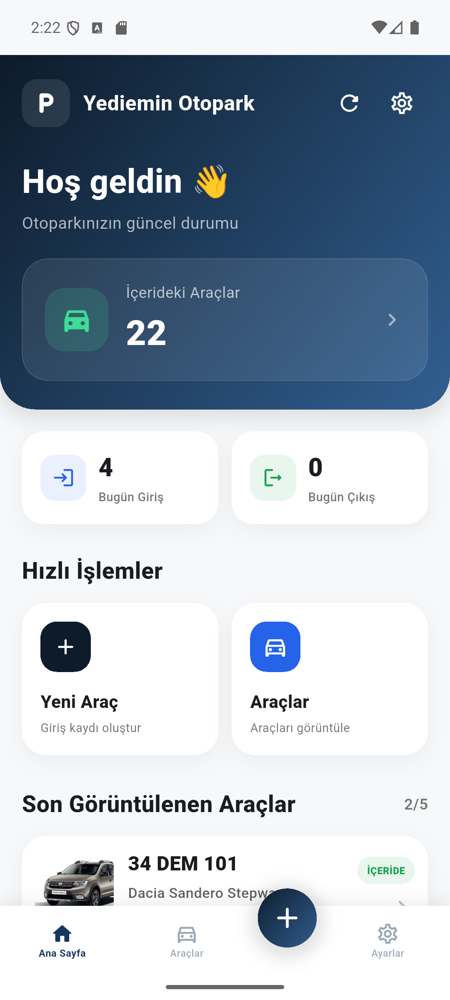
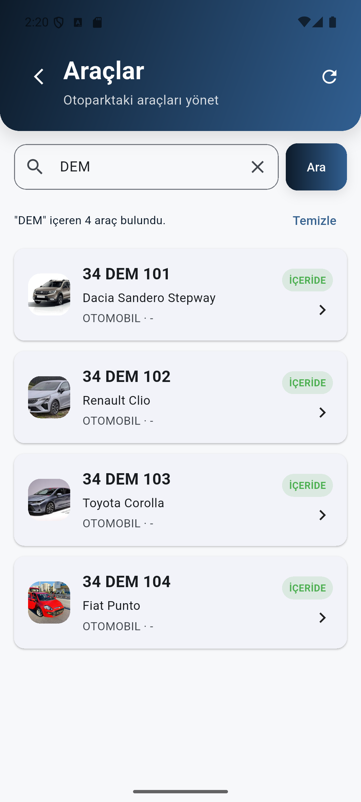
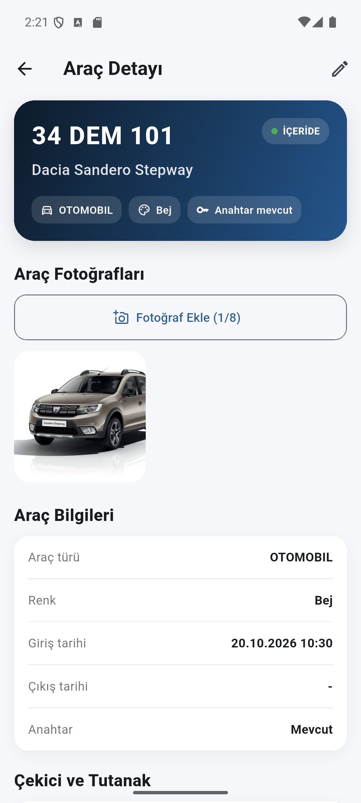
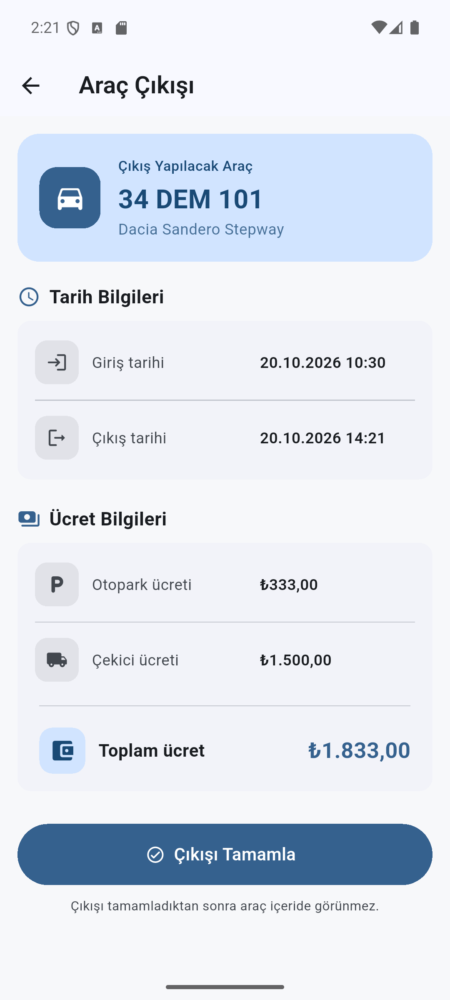

<div align="center">

# 🚗 Yediemin Otopark Management System

### Full-Stack Vehicle Impound Lot Management Application

A mobile-first application designed to digitize vehicle impound lot operations, manage vehicle records, track entry and exit processes, and calculate parking fees.


</div>

---

## 📖 Overview

**Yediemin Otopark** is a full-stack mobile application developed to replace traditional paper-based vehicle impound lot records with a centralized digital management system.

The system supports the complete vehicle lifecycle, from initial registration and photo documentation to parking fee calculation and vehicle release.

The project demonstrates RESTful API development, layered backend architecture, relational database management, cloud-based image processing, and mobile application development.

## 📱 Application Preview

<table>
  <tr>
    <th>Dashboard</th>
    <th>Vehicle List</th>
  </tr>
  <tr>
    <td align="center"><a href="docs/screenshots/dashboard.png"></a></td>
    <td align="center"><a href="docs/screenshots/vehicles.png"></a></td>
  </tr>
  <tr>
    <th>Vehicle Details</th>
    <th>Vehicle Exit</th>
  </tr>
  <tr>
    <td align="center"><a href="docs/screenshots/vehicle-details.png"></a></td>
    <td align="center"><a href="docs/screenshots/vehicle-exit.png"></a></td>
  </tr>
</table>

Screenshots captured from the Android emulator using the local backend. Demo plates and transaction details are fictional; vehicle photos are representative images from the project's existing sample uploads.

## ✨ Key Features

### 🚘 Vehicle Management

- Register new vehicles with detailed information
- Update and delete vehicle records
- Track vehicle entry and exit dates
- Search vehicles by license plate
- Filter vehicles by parking status
- Paginated vehicle listing

### 💰 Parking & Towing Fees

- Vehicle-type-based daily parking tariffs
- Automatic parking fee calculation
- Towing fee recording
- Towing payment status tracking
- Exit fee calculation
- Vehicle exit reversal

### 📷 Photo Management

- Upload multiple vehicle photos
- Cloudinary integration for image storage
- Image resizing and compression
- Maximum of 8 photos per vehicle
- Photo deletion and retrieval

### 📊 Dashboard

- Total vehicles currently inside
- Today's vehicle entries
- Today's vehicle exits
- Recently viewed vehicles

## 🛠️ Technology Stack

| Layer              | Technologies                    |
| ------------------ | ------------------------------- |
| Mobile Application | Flutter, Dart                   |
| Backend            | Java 21, Spring Boot            |
| API                | RESTful Web Services            |
| Database           | PostgreSQL                      |
| ORM                | Spring Data JPA, Hibernate      |
| Cloud Storage      | Cloudinary                      |
| Image Processing   | Thumbnailator                   |
| Build Tools        | Maven, Gradle                   |
| Containerization   | Docker                          |
| Development Tools  | IntelliJ IDEA, VS Code, Postman |

## 🏗️ System Architecture

The backend follows a layered architecture to separate HTTP handling, business logic, and data persistence.

```text
         Flutter Mobile Application
                    |
                    | HTTP / REST / JSON
                    |
             Spring Boot API
                    |
              Controllers
                    |
             Service Layer
                    |
             Repository Layer
                    |
                PostgreSQL

             Photo Management
                    |
                Cloudinary
```

### Backend Components

- **Controller:** REST endpoint management
- **Service:** Business logic and validation
- **Repository:** Database access using JPA
- **Entity:** Database models and relationships
- **DTO:** Data transfer between application layers
- **Mapper:** Entity and DTO transformations
- **Exception Handler:** Centralized exception handling

## 📁 Project Structure

```text
Yediemin-Otopark/
|
├── src/
│   ├── main/
│   │   ├── java/com/yediemin/backend/
│   │   │   ├── config/
│   │   │   ├── controller/
│   │   │   ├── dto/
│   │   │   ├── entity/
│   │   │   ├── enums/
│   │   │   ├── exception/
│   │   │   ├── mapper/
│   │   │   ├── repository/
│   │   │   └── service/
│   │   └── resources/
│   └── test/
|
├── lib/
│   ├── models/
│   ├── screens/
│   ├── services/
│   └── main.dart
|
├── android/
├── ios/
├── web/
├── linux/
├── macos/
├── windows/
|
├── pom.xml
├── pubspec.yaml
├── Dockerfile
├── flutter_01.png
└── README.md
```

The repository contains both the Spring Boot backend and the Flutter application.

## 🔌 REST API Examples

| Method | Endpoint                         | Description              |
| ------ | -------------------------------- | ------------------------ |
| POST   | `/arac`                          | Register a vehicle       |
| GET    | `/arac/liste`                    | List vehicles            |
| GET    | `/arac/ara`                      | Search by license plate  |
| GET    | `/arac/detay/{publicId}`         | Vehicle details          |
| PUT    | `/arac/{id}`                     | Update vehicle           |
| DELETE | `/arac/{id}`                     | Delete vehicle           |
| PUT    | `/arac/{id}/cikis`               | Process vehicle exit     |
| GET    | `/arac/{publicId}/cikis-ucreti`  | Calculate exit fee       |
| GET    | `/dashboard/ozet`                | Dashboard summary        |
| POST   | `/fotograf/yukle/{aracPublicId}` | Upload vehicle photo     |
| GET    | `/tarife`                        | Retrieve parking tariffs |

## ⚙️ Local Development

### Prerequisites

- Java 21
- PostgreSQL
- Flutter SDK
- Android Studio or a compatible Flutter development environment
- Cloudinary account for image management

### 1. Clone the repository

```bash
git clone https://github.com/cemozkan1454/Yediemin-Otopark.git
cd Yediemin-Otopark
```

### 2. Configure the backend

Create a PostgreSQL database named `yediemin`.

The backend uses environment variables for database and Cloudinary credentials.

Example for PowerShell:

```powershell
$env:SPRING_DATASOURCE_URL="jdbc:postgresql://localhost:5432/yediemin"
$env:SPRING_DATASOURCE_USERNAME="your_username"
$env:SPRING_DATASOURCE_PASSWORD="your_password"

$env:CLOUDINARY_CLOUD_NAME="your_cloud_name"
$env:CLOUDINARY_API_KEY="your_api_key"
$env:CLOUDINARY_API_SECRET="your_api_secret"
```

Do not commit actual credentials.

### 3. Start the Spring Boot backend

On Windows:

```powershell
.\mvnw.cmd spring-boot:run
```

The API uses port `8080` by default.

### 4. Run the Flutter application

Open another terminal in the project root.

```bash
flutter pub get
```

For an Android emulator accessing a local backend:

```bash
flutter run --dart-define=API_URL=http://10.0.2.2:8080
```

Local HTTP connections may require additional Android network security configuration.

For physical devices, configure an API address reachable from the device.

## 🔐 Security & Deployment Notes

- Database credentials are provided through environment variables.
- Cloudinary credentials are not hardcoded.
- Local configuration files and uploaded user data are excluded from version control.
- Authentication and authorization must be implemented before exposing the backend to untrusted networks.

This repository is presented as a development and portfolio project, not a production-ready public service.

## 🎯 Project Purpose

The main objective is to modernize manual vehicle impound lot management through a digital solution.

This project demonstrates practical experience in:

- Full-stack application development
- Java and Spring Boot REST API design
- Layered software architecture
- PostgreSQL database integration
- Flutter mobile UI development
- Cloud-based image management
- Business process digitization

---

## 👨‍💻 Developer

**Cem Özkan**

Management Information Systems Graduate  
Full-Stack Development | Java | Spring Boot | Flutter

GitHub: [@cemozkan1454](https://github.com/cemozkan1454)

---

<div align="center">

**Developed with Java, Spring Boot, Flutter and PostgreSQL.**

</div>
